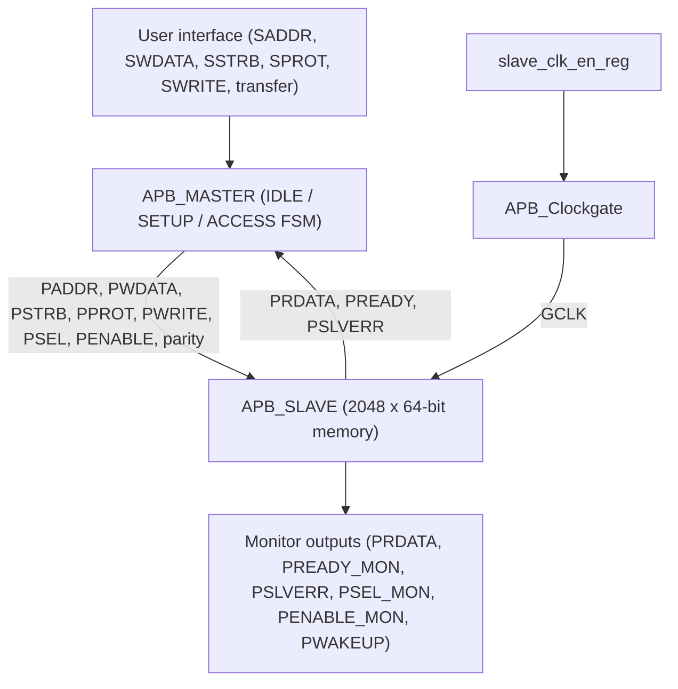

# AMBA APB Master-Slave Interface on Spartan-7 (SP701 board, part No: xc7s100fgga676-2)

**RTL Design | Verilog | Verification | FPGA**

## Contents

- [Overview](#overview)
- [Target Device](#target-device)
- [Architecture](#architecture)
- [Subcomponents](#subcomponents)
- [FSM](#fsm)
- [Parameters](#parameters)
- [Bus Signals and Internal Registers](#bus-signals-and-internal-registers)
- [User I/O](#user-io)
- [Implementation Results](#implementation-results)
- [XDC Constraints](#xdc-constraints)
- [Timing Summary](#timing-summary)
- [Power Summary](#power-summary)
- [Implementation Notes](#implementation-notes)
- [Verification](#verification)
- [Project Files](#project-files)

## Overview

This project implements an AMBA APB (Advanced Peripheral Bus) master and slave in Verilog and connects them in a wrapper that also gates the slave clock. Both blocks are 64 bits wide (64-bit address, 64-bit data, 8 byte strobes) and carry parity bits on address, protection, strobe and write data. The slave contains a 2048 x 64-bit memory and responds with zero wait states. A simple user-side interface (`SADDR`, `SWDATA`, `SSTRB`, `SPROT`, `SWRITE`, `transfer`) drives the master, and the wrapper exposes the read data and the main bus handshake signals as monitor outputs.

## Target Device

| Item | Value |
|---|---|
| Device | xc7s100fgga676-2 (Spartan-7) |
| Board | Xilinx SP701 (`xilinx.com:sp701:part0:1.1`) |
| Package / speed grade | FGGA676 / -2 |
| Tool | Vivado v2026.1 (win64), Build 6511674 |
| Top module | `APB_WRAPPER` (simulation top: `APB_tb`) |
| Device resources | 64,000 LUTs, 128,000 flip-flops, 120 RAMB36, 160 DSP, 400 bonded IOB |

## Architecture

The user interface asks the master to start a transfer. The master moves through `IDLE`, `SETUP` and `ACCESS` phases, drives the APB signals and waits for `PREADY` from the slave. The slave decodes the address, reads or writes its memory, returns `PRDATA` and reports errors on `PSLVERR`. The slave runs on a gated clock: a registered enable (`slave_clk_en_reg`, asynchronously preset by `PRESETn`) feeds the clock-gate cell (`APB_Clockgate`), whose output `GCLK` clocks the slave.



*Block-level architecture of the APB wrapper.*


*Elaborated design from Vivado: 4 cells, 212 I/O ports and 358 nets.*

## Subcomponents

The elaborated design contains **4 cells** in the wrapper: 3 Verilog sub-modules and 1 register.

| # | Subcomponent | Source file | Function |
|---|---|---|---|
| 1 | `APB_MASTER` | `APB_MASTER.v` | Three-state FSM (`cs_reg`: IDLE, SETUP, ACCESS), generates the APB signals and parity bits |
| 2 | `APB_SLAVE` | `APB_SLAVE.v` | 2048 x 64-bit memory, read/write handling, `PREADY` / `PSLVERR`, parity checking |
| 3 | `APB_Clockgate` | `APB_Clockgate.v` | Latch-based clock gate that produces `GCLK` for the slave |
| 4 | `slave_clk_en_reg` | inside `APB_WRAPPER.v` | Register with asynchronous preset that holds the clock-gate enable |

The top module `APB_WRAPPER` (`APB_WRAPPER.v`) instantiates these blocks. Vivado's RTL statistics list 5 x 64-bit and 2 x 8-bit and 2 x 3-bit XOR trees (the parity generators and checkers), 2 x 64-bit, 1 x 8-bit and 3 x 1-bit registers, one 8-bit adder, 14 x 64-bit 2-input multiplexers and one 2048 x 64-bit RAM.

## FSM


*APB master state machine, following the standard APB phase order (sequential encoding: IDLE = 00, SETUP = 01, ACCESS = 10).*

## Parameters

| Module | Parameter | Value | Meaning |
|---|---|---|---|
| `APB_MASTER` | `ADDR_WIDTH` | 64 | Address width |
| `APB_MASTER` | `DATA_WIDTH` | 64 | Data width |
| `APB_MASTER` | `ENABLE_PARITY` | 1 | Parity generation enabled |
| `APB_SLAVE` | `ADDR_WIDTH` | 64 | Address width |
| `APB_SLAVE` | `DATA_WIDTH` | 64 | Data width |
| `APB_SLAVE` | `MEM_DEPTH` | 2048 | Number of 64-bit words in the slave memory |
| `APB_SLAVE` | `ENABLE_PARITY` | 1 | Parity checking enabled |
| `APB_SLAVE` | `NUM_WAIT_STATES` | 0 | Wait states inserted before `PREADY` |

## Bus Signals and Internal Registers

| Signal | Width | Direction (master to slave unless noted) | Purpose |
|---|---|---|---|
| `PADDR` / `PADDRPAR` | 64 / 1 | Master to slave | Address and its parity |
| `PWDATA` / `PWDATAPAR` | 64 / 1 | Master to slave | Write data and its parity |
| `PSTRB` / `PSTRBPAR` | 8 / 1 | Master to slave | Byte strobes and their parity |
| `PPROT` / `PPROTPAR` | 3 / 1 | Master to slave | Protection attributes and their parity |
| `PSEL`, `PENABLE`, `PWRITE` | 1 each | Master to slave | Select, enable and direction |
| `PWAKEUP` | 1 | Master to slave | Wake-up request |
| `PRDATA` | 64 | Slave to master | Read data |
| `PREADY`, `PSLVERR` | 1 each | Slave to master | Transfer complete and error flag |
| `cs_reg` | 2 | Internal | Master FSM state register |
| `en_latched_reg` | 1 | Internal (clock gate) | Latched clock enable (inferred latch) |
| `slave_clk_en_reg` | 1 | Internal (wrapper) | Registered clock-gate enable |

## User I/O

| Group | Signals | Direction | Bits |
|---|---|---|---|
| Clock and reset | `PCLK`, `PRESETn` | In | 2 |
| Transfer request | `transfer`, `SWRITE` | In | 2 |
| Request address | `SADDR[63:0]` | In | 64 |
| Request data | `SWDATA[63:0]` | In | 64 |
| Request strobes / protection | `SSTRB[7:0]`, `SPROT[2:0]` | In | 11 |
| Read data | `PRDATA[63:0]` | Out | 64 |
| Monitor and status | `PREADY_MON`, `PSLVERR`, `PSEL_MON`, `PENABLE_MON`, `PWAKEUP` | Out | 5 |

**Totals:** **212 user I/O ports** (143 inputs and 69 outputs). After implementation, 209 bonded IOBs are used, which is 52.25% of the 400 available.

## Implementation Results

| Resource | Used | Available | Util % |
|---|---|---|---|
| Slice LUTs (all logic) | 67 | 64,000 | 0.10 |
| Slice registers (68 flip-flops + 1 latch) | 69 | 128,000 | 0.05 |
| Slices | 53 | 16,000 | 0.33 |
| Block RAM (RAMB36) | 4 | 120 | 3.33 |
| DSP | 0 | 160 | 0.00 |
| Bonded IOB | 209 | 400 | 52.25 |
| BUFGCTRL | 2 | 32 | 6.25 |
| Unique control sets | 4 | 16,000 | 0.03 |

The 2048 x 64-bit slave memory (128 Kbit) maps to 4 RAMB36 blocks. Synthesis finished with 0 errors, 0 critical warnings and 66 warnings. The design was placed and routed with no routing errors.

## XDC Constraints

The constraint file (`APB_Constratints.xdc`) defines the clock, the pin and I/O standard assignments and the power-analysis conditions. The clock is reported by Vivado as `sys_clk_pin`: 10.000 ns period (100 MHz), waveform {0.000 5.000}. The listing below is reconstructed from the implementation constraints that Vivado recorded for this run.

```tcl
# Clock (as reported by Vivado): sys_clk_pin, period 10.000 ns, waveform {0.000 5.000}
set_property -dict {PACKAGE_PIN L25 IOSTANDARD LVCMOS18} [get_ports PCLK]
set_property CLOCK_DEDICATED_ROUTE FALSE [get_nets PCLK_IBUF]

# Control inputs
set_property -dict {PACKAGE_PIN A18 IOSTANDARD LVCMOS18} [get_ports PRESETn]
set_property -dict {PACKAGE_PIN C18 IOSTANDARD LVCMOS18} [get_ports transfer]
set_property -dict {PACKAGE_PIN A17 IOSTANDARD LVCMOS18} [get_ports SWRITE]

# Default I/O standard for every remaining port
set_property IOSTANDARD LVCMOS18 [get_ports -filter {IOSTANDARD == DEFAULT}]

# Power analysis conditions
set_operating_conditions -process typical
set_operating_conditions -junction_temp 60.0
set_operating_conditions -design_power_budget 5.0
set_switching_activity -toggle_rate 10.0 -static_probability 0.5 [get_ports {PRDATA[*]}]
set_switching_activity -toggle_rate 5.0  -static_probability 0.5 [get_ports {SADDR[*]}]
set_switching_activity -toggle_rate 5.0  -static_probability 0.5 [get_ports {SWDATA[*]}]
```

| Signals | Pins | I/O standard |
|---|---|---|
| `SADDR[3:0]` | V16, W16, W17, W15 | LVCMOS18 |
| `SWDATA[3:0]` | V15, W14, W13, V10 | LVCMOS18 |
| `SSTRB[3:0]` | T3, U1, T1, R2 | LVCMOS18 |
| `SPROT[2:0]` | W2, U2, T2 | LVCMOS18 |
| `PSLVERR`, `PWAKEUP` | U16, E19 | LVCMOS18 |
| `PSEL_MON`, `PENABLE_MON`, `PREADY_MON` | U19, M19, W18 | LVCMOS18 |
| `PRDATA[3:0]`, `PRDATA[44:10]` | J23, J29, M27, P22 and 35 further pins (J24, L22, L23, K23 ... P19) | LVCMOS18 |

The rest of the ports (for example `SADDR[63:4]` and `PRDATA[63:45]`) have no pin assignment in the file and were placed by the tool.

## Timing Summary

All user-specified timing constraints are met: worst setup slack is +2.980 ns, worst hold slack is +0.243 ns and worst pulse-width slack is +4.500 ns, with no failing endpoints.

| Check | Worst slack | Total negative slack | Failing endpoints | Total endpoints |
|---|---|---|---|---|
| Setup (WNS / TNS) | 2.980 ns | 0.000 ns | 0 | 141 |
| Hold (WHS / THS) | 0.243 ns | 0.000 ns | 0 | 141 |
| Pulse width (WPWS / TPWS) | 4.500 ns | 0.000 ns | 0 | 79 |


*Vivado Design Timing Summary (routed design, 100 MHz clock).*

## Power Summary

Total on-chip power is 0.174 W, well inside the 5 W budget set in the constraints. Static power dominates (88%), and 71% of the dynamic power is in the I/O.

| Metric | Value |
|---|---|
| Total on-chip power | 0.174 W |
| Design power budget / margin | 5 W / 4.826 W |
| Dynamic power | 0.020 W (12%) |
| Dynamic: clocks | 0.002 W (9%) |
| Dynamic: signals | 0.002 W (8%) |
| Dynamic: logic | 0.001 W (3%) |
| Dynamic: block RAM | 0.002 W (9%) |
| Dynamic: I/O | 0.015 W (71%) |
| Device static power | 0.153 W (88%) |
| Junction temperature | 60.0 °C (set in the constraints) |
| Thermal margin | 25.0 °C (10.2 W) |
| Ambient temperature | 59.576 °C |
| Effective θJA | 2.4 °C/W |
| Process | typical |
| Confidence level | Medium |


*Vivado power analysis of the implemented netlist.*

## Implementation Notes

Vivado's design-rule and methodology checks flag the following. They are listed here so the limits of this build are clear:

| Check | Severity | Meaning in this design |
|---|---|---|
| NSTD-1 | Critical Warning | 183 of 209 logical ports use the default I/O standard instead of a user-assigned one |
| UCIO-1 | Critical Warning | Some logical ports have no pin constraint |
| TIMING-14 | Critical Warning | A LUT sits on the clock tree (the clock-gate logic) |
| TIMING-18 | Warning | 208 ports have no input or output delay constraint |
| LATCH-1 | Advisory | 1 latch exists in the design (the clock-gate enable latch) |
| CFGBVS-1 | Warning | `CFGBVS` and `CONFIG_VOLTAGE` are not set |

## Verification

The testbench (`APB_tb.v`) drives the user interface and the waveform below covers the first 440 ns. After reset is released, `transfer` is asserted and the stimulus steps through different addresses (including `0x3ff` and `0x33`), write data (`0xccccdddd` and others) and byte-strobe patterns (`f`, `6`, `9`, `7`, `0`). Reset is applied a second time at about 190 ns. `PRDATA` reads as zero until about 270 ns and then shows unknown (`x`) values for the rest of the captured window, so the read-back data is not yet confirmed in this capture.


*Simulation waveform, 0 to 440 ns.*

## Project Files

The project contains:

- RTL source: `APB_WRAPPER.v`, `APB_MASTER.v`, `APB_SLAVE.v` and `APB_Clockgate.v`.
- Testbench: `APB_tb.v`.
- FPGA constraints: `APB_Constratints.xdc`.
- Power-analysis activity file: `apb.saif` from the simulation run.

---

&copy; 2026 Aravindakshan GA. All rights reserved.
